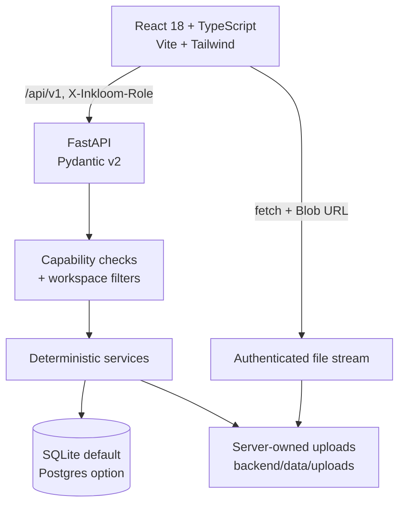

# Inkloom AI — Architecture

## 1. Purpose and boundaries

Inkloom AI demonstrates an evidence-first governance workflow: submit content, compare it with stored brand rules and approved facts, inspect findings, revise into a new version, and route that exact version through human review.

The architectural rule is simple: **a finding must come from a stored rule or approved fact, and an operation that did not run must say so.** This is why the audit path contains no language model, OCR, or speech-to-text calls, and why the interface exposes processing boundaries instead of hiding them.

Non-goals in this build: production authentication, external AI, image OCR, speech-to-text, and multi-node storage. See the limitations section at the end.

---

## 2. System context

There is no browser-side database client and no secret in the frontend. The browser only knows the API base URL and the selected demo role.

---

## 3. Frontend

- **Shell**: fixed desktop sidebar, sticky top bar, mobile drawer (dialog semantics), role switcher, assistant entry point.
- **Routing**: a small hash router maps routes to pages (`src/lib/router.ts`, `src/App.tsx`). Access requirements are declared in `src/lib/navigation.ts` and checked in the shell.
- **Pages**: Overview, Content list, New content, Document workspace, Reviews, Campaigns, Campaign detail, Brand library, Policies & brand memory, History, Insights, Research, Evaluation, Team, Settings.
- **Session context**: loads `/session`, exposing the active user, role, workspace, capabilities, and demo flag.
- **API client**: `src/services/api.ts` is a typed wrapper. Errors are normalized into `ApiError` so pages can show server messages.
- **Evidence rendering**: findings show affected text, location, rule/fact reference, verification status, score deductions, and actions. Tabs announce selection with `aria-pressed`.
- **PDF viewer**: downloads the file through the authenticated endpoint, creates a Blob URL, and renders it in an iframe. The URL is revoked when no longer needed.
- **Video player**: renders `<video>` only when a stored file exists. Transcript-only assets show an explicit empty-file state.

State is local to each page; there is no client cache layer. Mutations reload the affected record so the UI reflects server state rather than optimistic guesses.

---

## 4. Demo identity and authorization

`backend/app/core/security.py` defines:

- `ROLE_CAPABILITIES` for `creator`, `reviewer`, and `admin`.
- `Actor`, carrying the resolved user, role, workspace, and capabilities.
- `require_caps(...)`, a FastAPI dependency that rejects missing capabilities with `403`.

Demo requests send `X-Inkloom-Role` and optionally `X-Inkloom-User`. The server resolves the user from the workspace, then every query filters by `workspace_id`. Record-level access checks prevent creators from reading another creator’s private draft.

**Boundary:** anyone can select a demo role in the browser. The server-side checks are real, but they are not identity verification. Production must replace this module with Supabase Auth (or equivalent) and derive roles from trusted claims.

---

## 5. Data model

| Entity | Role |
| --- | --- |
| `Workspace` | Tenant boundary, demo flag, settings |
| `UserProfile` | Demo users and role assignment |
| `BrandRule` | Deterministic rule: type, pattern, severity, status, guidance, version |
| `ApprovedFact` | Source-backed claim, approved value, status, version, review dates |
| `BrandAsset` | Visual asset metadata and contrast information |
| `UploadedFile` | Stored file metadata, checksum, extraction status and messages |
| `ContentDocument` | Asset type, owner, campaign, status, current version, approval pointer |
| `ContentVersion` | Immutable text, page texts, transcript, change summary |
| `AuditRun` | Score, risk level, method, verification status, risk factors |
| `AuditFinding` | Category, severity, quote, page/timestamp, source, status, resolution |
| `ApprovalDecision` | Version-bound decision, reviewer, feedback |
| `ReviewComment` | Version-aware discussion |
| `AuditHistoryEvent` | Append-only workflow events |
| `Campaign` / `CampaignConflict` | Cross-asset claim consistency and resolution records |
| `ResearchRecord` | Planned/completed research with sources and structured details |
| `EvaluationCase` / `EvaluationRun` | Fixtures and measured deterministic outcomes |

The SQLAlchemy models are the source of truth. The starter migrations in `supabase/migrations/` cover only the early core tables (workspaces, users, rules, facts, content, audits, reviews, history) with RLS and a smaller seed. Campaigns, campaign conflicts, uploads, brand assets, research, and evaluation are not in the migrations; the runtime creates them from the models. A real Postgres deployment needs a reviewed migration generated from the current models.

---

## 6. Audit pipeline

### 6.1 Ingestion

`backend/app/services/ingestion.py` validates type and size, writes a server-generated safe filename, and records an `UploadedFile`.

Supported types:

| Kind | Formats | Limit |
| --- | --- | --- |
| PDF | `.pdf` | 25 MiB, 120 pages |
| Image | PNG/JPEG/WebP | 25 MiB |
| Video | MP4/WebM/MOV | 120 MiB |
| Transcript | TXT/VTT/SRT | 25 MiB |

PDF extraction uses `pypdf`, preserving each page’s text. Encrypted, empty, over-limit, or unreadable PDFs return a structured extraction message. Image uploads record an OCR-unavailable boundary; no text is invented. Video files are stored but checks use a supplied transcript.

### 6.2 Rule scanning

`audit_engine.scan_rules` evaluates active rules against extracted text:

- prohibited phrase / claim restriction / tone / product naming / required terminology;
- literal or regex matching, case-insensitive;
- optional trigger phrase;
- replacement guidance attached to each finding.

### 6.3 Approved-fact checks

- **Contradictions**: percentage and numeric values near a claim are compared with the approved fact. A `100%` uptime claim against a `99.9%` SLA produces a confirmed contradiction.
- **Unsupported quantitative claims**: figures without an approved reference are marked for human review rather than being called false.
- **Ambiguous claims**: market-rank/superlative language without a citation is surfaced as unsupported.

Findings are deduplicated and scored by category/severity deductions. The score is `max(0, 100 - total_deduction)`, with grouped risk factors and a method label. This score is a workflow aid, not a legal or scientific rating.

### 6.4 Verification status

Each run declares how it was produced (deterministic rules, PDF page scan, transcript scan) and whether findings are backed by a stored rule/fact, need human review, or could not be verified. The UI renders that status rather than implying universal certainty.

### 6.5 Persistence

Submitting a check creates an audit run and findings tied to the immutable version. Re-running after edits creates a new version; history is never rewritten.

---

## 7. PDF and video evidence

### PDF
1. Validate limit and MIME type.
2. Extract each page’s text and store it on the version.
3. Audit each page separately so findings carry `page_number`.
4. Store extraction status/message on the uploaded file.
5. Serve the file only through `GET /api/v1/uploads/{id}/file`, with capability/workspace checks.
6. If no text is available, offer manual page text; page boundaries are retained and `file_id` stays `null`.

### Video
1. Validate extension/MIME and size.
2. Store the file and expose playback through the authenticated endpoint.
3. Parse supplied transcript segments using `[MM:SS]` markers (falling back to sentence timestamps only when no markers exist).
4. Audit each segment and attach `timestamp_seconds` and a formatted location label.
5. Do not generate timestamps, transcripts, or a player when the corresponding source is absent.

---

## 8. Campaign governance

`campaign_service.py` extracts claims from each attached asset’s current version:

- currency amounts and pricing phrases;
- availability/SLA percentages;
- performance multipliers;
- selected factual claim patterns.

Claims are normalized and compared across assets. Conflicts record both asset values, locations, the approved reference if one exists, and an evidence note. Running a check persists detected conflicts.

Readiness combines attached assets, current approved versions, open checks, unresolved conflicts, and stale approvals into pass / needs-attention items. Resolution records an agreed value and a note; it does **not** silently edit asset copy. The user must update content and re-check, which keeps the audit trail honest.

---

## 9. Brand memory and policy simulation

- **Approved facts** carry a source reference, status, version, owner, and next review date. Retiring a fact marks it expired; historical findings keep their record.
- **Rules** carry type, pattern, severity, guidance, and active/draft/archived status. Only active rules are evaluated.
- **Impact analysis** counts current documents and versions that would be affected by changing a fact or rule.
- **Rule simulation** counts literal matches across stored text and returns matching documents and snippets. It does not predict legal risk.
- **Draft suggestions** come from open findings with no matching rule; creating one produces an inactive draft for admin review.
- **Contrast checker** computes WCAG 2.1 ratios from two hex colors on the server, reporting only contrast, not overall accessibility approval.

---

## 10. Review, versioning, and history

- Saving a revision creates a new immutable `ContentVersion`.
- Submitting for review records the exact version.
- Decisions are stored against a version; if the document advances, the UI marks the approval stale.
- Request changes/reject require feedback.
- Comments and decisions produce append-only history events.
- Version comparison is a line-based diff of stored text. PDF diffs reflect extracted text order, not visual layout.

---

## 11. Assistant

`assistant_service.py` is deterministic. It:

1. resolves accessible content for the actor;
2. retrieves the latest audit, findings, decisions, rules, facts, campaign conflicts, and research records relevant to the question;
3. composes a reply with grounding items and suggested navigation actions;
4. declares `mode="rule_based"` and a verification status (`verified_from_workspace_records`, `general_guidance`, or `unable_to_verify`);
5. states its limitations, including that no external model is configured.

It cannot answer general world knowledge as an LLM would, and the UI does not present it as one.

---

## 12. Research, evaluation, and insights

- **Research**: records section, status, summary, structured details, sources, owner. Completion requires a titled source. The UI labels planned work as not conducted.
- **Evaluation**: fixed cases with expected categories/text/locations are executed through the real engine. Each run stores the actual findings, checks, score, and model/engine label. Results are a regression fixture, not an external benchmark.
- **Insights**: aggregates stored runs/findings by category, rule, severity, and trend. No synthetic telemetry is injected.

---

## 13. Security and trust controls

- Role capabilities are re-checked server-side on every protected route.
- Queries filter by `workspace_id`; creator draft access is additionally restricted.
- Uploads are size/type validated; filenames are sanitized and server-generated.
- File downloads require authorization and stream through the API; no static upload directory is served.
- CORS is configured explicitly; credentials are not stored in the browser.
- Integration endpoints expose configuration *names and states*, never secret values.
- The generic 500 handler returns a safe message and logs details server-side.
- Demo data is labelled in the shell, records, and seeded content.

Not provided: production login, password reset, audit logging to an external SIEM, rate limiting, or malware scanning. These are required before real-world use.

---

## 14. Persistence and deployment

- **Default**: SQLite at `backend/inkloom.db`; demo seed runs on an empty database.
- **Optional**: PostgreSQL/Supabase via `DATABASE_URL`. SQLAlchemy creates the runtime tables; the bundled SQL migrations are an incomplete starter subset and must not be used as the authoritative production schema. The demo runtime connects with a trusted server credential, so RLS is not the runtime authorization boundary here.
- **Uploads**: local `backend/data/uploads` by default. Use object storage with signed URLs for multi-instance deployment.
- **Backend container**: `backend/Dockerfile` (Python 3.11 slim, Uvicorn).
- **Backend process**: `backend/Procfile`.
- **Frontend**: static Vite build. `frontend/vercel.json` rewrites all paths to `index.html`; `VITE_API_BASE_URL` must point at a reachable API when deployed separately.

---

## 15. Verification approach

- **Backend tests** (`backend/tests`): API permissions, seed integrity, PDF page linkage, transcript timestamps, image OCR boundary, revision/review/stale approval, campaign conflicts, brand memory, research source requirement, evaluation execution, secret-safe integrations, assistant declarations, upload limits, deterministic engine units.
- **Frontend build**: `tsc` then Vite production build.
- **Browser checks**: responsive sweep across all routes and three widths; creator/reviewer workflow; admin workflow. These run against an isolated copy of the demo database so seeded demo records stay clean.
- There is no lint script or ESLint configuration in the repository; TypeScript is the static check.

---

## 16. Known constraints

- Deterministic matching cannot understand tone, sarcasm, or visual context.
- PDF extraction does not preserve columns/tables or render layout.
- No OCR for images/scans; no transcription or frame analysis for video.
- No external LLM; assistant answers are limited to stored workspace records and declared guidance.
- Single-node SQLite/local file storage; no background workers or notifications.
- Demo role headers are not authentication; RLS is not enforced on the local trusted connection.
- The five evaluation cases are synthetic fixtures, not a benchmark.
