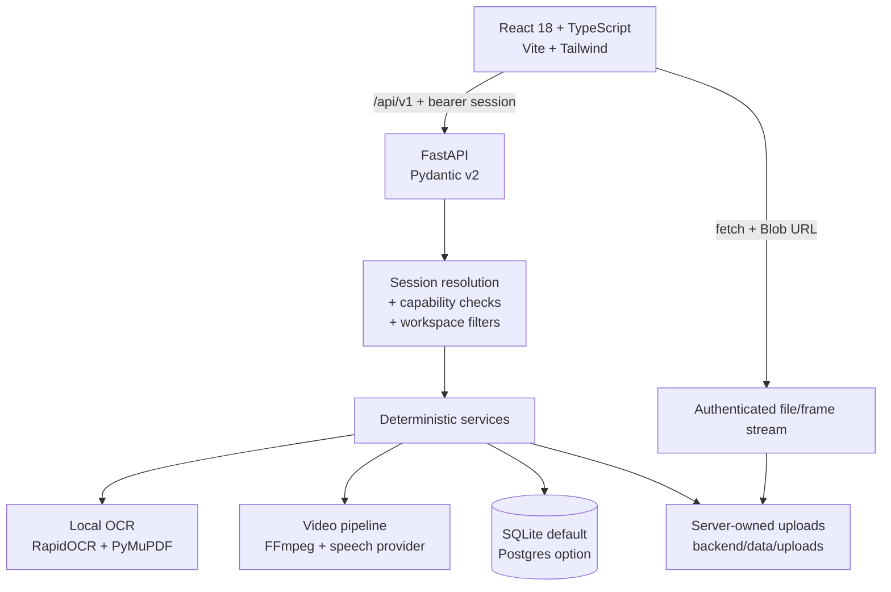

# Inkloom AI — Architecture

## 1. Purpose and boundaries

Inkloom AI demonstrates an evidence-first governance workflow: submit content, compare it with stored brand rules and approved facts, inspect findings, revise into a new version, and route that exact version through human review.

The architectural rule is simple: **a finding must come from a stored rule or approved fact, and an operation that did not run must say so.** The audit path contains no language model. Text from images, scanned PDF pages, and sampled video frames comes from a local OCR engine; video speech comes from the speech-to-text provider configured on the server. Extracted text, confidence/location metadata, provider timestamps, and configuration states are stored and fed to the same deterministic rules, so OCR and transcription never invent a finding on their own.

Non-goals in this build: production authentication (demo accounts only), language-model audit decisions, a distributed job queue, and multi-node storage. See the limitations section at the end.

---

## 2. System context

There is no browser-side database client and no secret in the frontend. The browser only knows the API base URL and holds an opaque session token in memory. The speech provider key is read only by the API.

---

## 3. Frontend

- **Shell**: dark fixed desktop sidebar, sticky top bar, mobile drawer (dialog semantics), workspace and role switchers, assistant entry point. Panels use layered translucent surfaces rather than flat fills.
- **Routing**: a small hash router maps routes to pages (`src/lib/router.ts`, `src/App.tsx`). Access requirements are declared in `src/lib/navigation.ts` and checked in the shell.
- **Pages**: Overview, Content list, New content, Document workspace, Reviews, Campaigns, Campaign detail, Brand library, Policies & brand memory, History, Insights, Research, Evaluation, Team, Settings.
- **Session context**: signs in through the demo auth endpoints, keeps the bearer token in memory, and exposes the active user, role, workspace, capabilities, and demo flag. Only the demo role/workspace selection is remembered for the next sign-in. If the session expires, the client re-signs in; `401` responses are surfaced instead of being ignored.
- **API client**: `src/services/api.ts` is a typed wrapper. Errors are normalized into `ApiError` so pages can show server messages.
- **Evidence rendering**: findings show affected text, location, rule/fact reference, verification status, score deductions, and actions. Tabs use `role="tab"`/`tabpanel` with `aria-selected`.
- **PDF viewer**: downloads the file through the authenticated endpoint, creates a Blob URL, and renders it in an iframe. The URL is revoked when no longer needed.
- **Video player and analysis panel**: renders `<video>` only when a stored file exists. Transcript-only assets show an explicit empty-file state. The New content page shows server-reported video stages (speech and on-screen OCR), lets the user retry, re-transcribe, or cancel, and polls persisted state while a job is active. Findings can seek the player and render an authenticated frame preview.

State is local to each page; there is no client cache layer. Mutations reload the affected record so the UI reflects server state rather than optimistic guesses.

### 3.1 Design system and 3D layering

The 2026-10-30 redesign is a presentation-layer change only: routes, hooks, API calls, and server contracts are unchanged.

- **Tokens** (`src/index.css`, `tailwind.config.js`): canvas `#070B18`, secondary `#0B1224`, raised `#111B32`, primary `#4388FF`, violet `#8765FF`, cyan `#36D9FF`, text `#F3F6FF`, muted `#A7B3CA`; Inter with system fallbacks. The page background combines fixed radial ambient gradients with a static, mask-faded perspective grid. There is no parallax.
- **Layer model**: depth is built from stacked surfaces, 1 px illuminated borders (`--line`, `--line-strong`), inset top highlights, ambient shadows, and restrained glows. Content, forms, tables, and charts remain flat and upright; no text is perspective-transformed.
- **Surface utilities**:
  - `.glass` — cards and panels, translucent gradient with 18 px blur and inset highlight.
  - `.glass-soft` — secondary rows and quieter containers, 14 px blur.
  - `.glass-strong` — menus, dialogs, drawers. It uses a fully opaque gradient (not a see-through blur) so underlying page content cannot ghost through overlays, plus 24 px blur and a stronger border.
  - `.glass-inset` — wells inside cards; `.glass-sheen` — static top-light; `.lift` — 200 ms hover elevation; `.glow-brand` / `.glow-violet` — primary and selected emphasis.
- **Shape and motion**: controls 8–12 px radius, cards 14–20 px, panels 18–24 px. Transitions are 150–250 ms; `prefers-reduced-motion: reduce` removes animation, transition duration, and hover lift.
- **Responsive strategy**: mobile single column; two columns at 768 px; persistent sidebar plus multi-column dashboards at 1024/1440 px. Wide tables scroll inside their own region (`overflow-x-auto` + `.tab-scroll`), never the page body. Dialogs and the assistant drawer become full-height sheets on narrow screens.
- **Shared primitives**: `src/components/ui.tsx` (Card, PageHeader, Button, Badge, StatusBadge, SeverityBadge, Tabs, Dialog, Field, EmptyState, ErrorState, Skeleton) and the shell carry the system, so pages inherit consistent surfaces, spacing, focus rings, and dialog behavior instead of re-implementing them.
- **Accessibility**: visible `:focus-visible` rings, labelled inputs, text labels on every status/severity badge, `aria-expanded`/`aria-haspopup` on menus, `role="menu"`/`menuitemradio` workspace options, tab keyboard navigation (Arrow/Home/End), dialog focus trapping and restoration, and screen-reader-only labels for icon-only actions.

---

## 4. Demo identity and authorization

`backend/app/core/security.py` defines:

- `ROLE_CAPABILITIES` for `creator`, `reviewer`, and `admin`.
- `Actor`, carrying the resolved user, role, workspace, and capabilities.
- `require_caps(...)`, a FastAPI dependency that rejects missing capabilities with `403`.

Sign-in flow:

1. The browser lists seeded demo accounts at `GET /api/v1/auth/demo/accounts` (public, fictional, no secrets).
2. `POST /api/v1/auth/demo/session` selects an account by `user_id` or by `role` + `workspace_id`. The server issues an opaque `ink_…` token, stores only its SHA-256 hash in `auth_sessions`, and returns the session, user, and workspace.
3. The browser keeps the token in memory and sends `Authorization: Bearer …`. On reload it re-signs in with the remembered demo role/workspace; expired sessions return `401`.
4. `get_actor` resolves the token hash to a stored session and user record. Role and workspace come from that record; client-declared role or workspace headers are ignored.
5. Every query filters by the resolved `workspace_id`, including upload metadata and file downloads. Record-level access checks prevent creators from reading another creator’s private draft.

Sessions expire after `SESSION_TTL_HOURS` (default 12). Logout revokes only the presented session, and each user keeps at most ten active sessions (the oldest are revoked).

**Boundary:** demo accounts are fictional and there is no password or external identity provider. The server-side checks are real, but production must replace this module with Supabase Auth (or equivalent) and derive roles from trusted claims.

---

## 5. Data model

| Entity | Role |
| --- | --- |
| `Workspace` | Tenant boundary, demo flag, settings |
| `UserProfile` | Demo users and role assignment |
| `AuthSession` | Hashed bearer token, user, workspace, expiry, demo flag |
| `BrandRule` | Deterministic rule: type, pattern, severity, status, guidance, version |
| `ApprovedFact` | Source-backed claim, approved value, status, version, review dates |
| `BrandAsset` | Visual asset metadata and contrast information |
| `UploadedFile` | Stored file metadata, checksum, extraction status and messages |
| `OcrLine` | Per-line OCR text, confidence, normalized bounding box, page number |
| `VideoExtraction` | Persisted video job: status, per-stage state/messages, transcript segments, provider/model, sampled frames, attempt, cancel flag |
| `ContentDocument` | Asset type, owner, campaign, status, current version, approval pointer |
| `ContentVersion` | Immutable text, page texts, transcript, change summary |
| `AuditRun` | Score, risk level, method, verification status, risk factors |
| `AuditFinding` | Category, severity, quote, page/timestamp, source, status, resolution |
| `ApprovalDecision` | Version-bound decision, reviewer, feedback |
| `ReviewAssignment` | Reviewer assigned to a document/version, instructions, status |
| `FindingOverride` | Dismissal record with reason, reviewer, rule and document references |
| `ReviewComment` | Version-aware discussion |
| `AuditHistoryEvent` | Append-only workflow events |
| `Campaign` / `CampaignConflict` | Cross-asset claim consistency and resolution records |
| `ResearchRecord` | Planned/completed research with sources and structured details |
| `EvaluationCase` / `EvaluationRun` | Fixtures and measured deterministic outcomes |

The SQLAlchemy models are the source of truth. `Base.metadata.create_all` creates the runtime tables; there is no Alembic history, so Round 3 additions are new tables (`auth_sessions`, `review_assignments`, `finding_overrides`, `ocr_lines`) rather than in-place migrations. The starter migrations in `supabase/migrations/` cover only the early core tables (workspaces, users, rules, facts, content, audits, reviews, history) with RLS and a smaller seed. Campaigns, campaign conflicts, uploads, OCR lines, brand assets, research, evaluation, assignments, overrides, and auth sessions are not in the migrations; the runtime creates them from the models. A real Postgres deployment needs a reviewed migration generated from the current models.

---

## 6. Audit pipeline

### 6.1 Ingestion

`backend/app/services/ingestion.py` validates type and size, writes a server-generated safe filename, and records an `UploadedFile`.

Supported types:

| Kind | Formats | Limit |
| --- | --- | --- |
| PDF | `.pdf` | 25 MiB, 120 pages |
| Image | PNG/JPEG/WebP | 25 MiB |
| Video | MP4/WebM/MOV | 120 MiB |
| Transcript | TXT/VTT/SRT | 25 MiB |

PDF extraction uses `pypdf`, preserving each page’s text. Pages with fewer than `OCR_MIN_NATIVE_CHARS` embedded characters are rendered with PyMuPDF at `OCR_RENDER_DPI` and read with RapidOCR, so a single PDF can mix native and OCR pages. Encrypted, empty, over-limit, or unreadable PDFs return a structured extraction message; an OCR page that yields no text is recorded as unreadable. Images are decoded and validated with Pillow (PNG/JPEG/WebP, pixel limit), then OCR-processed into lines with confidence, normalized bounding boxes, and page number. Extraction failure or unavailable OCR records a processing-limitation finding; no text is invented.

Video files are validated (extension, MIME, container signature, 120 MiB limit), stored, and queued for automatic extraction. FFmpeg resolves from `FFMPEG_PATH`, a system install, or the bundled `imageio-ffmpeg` binary. The speech stage calls the configured OpenAI-compatible transcription provider and preserves its segment timestamps. The visual stage samples a bounded number of frames and reads them with the same local OCR engine. Both stages persist independently; see §6.6 and §7.

OCR is bounded by page count, image pixels, and a wall-clock timeout. The engine loads lazily and reports its availability through `/health` (`integrations.ocr_configured`, `ocr_provider`, `ocr_reason`). `OCR_PROVIDER=none` disables it and the API states that boundary.

### 6.2 Rule scanning

`audit_engine.scan_rules` evaluates active rules against extracted text:

- prohibited phrase / claim restriction / tone / product naming / required terminology;
- literal or regex matching, case-insensitive;
- optional trigger phrase;
- replacement guidance attached to each finding.

### 6.3 Approved-fact checks

- **Contradictions**: percentage and numeric values near a claim are compared with the approved fact. A `100%` uptime claim against a `99.9%` SLA produces a confirmed contradiction.
- **Unsupported quantitative claims**: figures without an approved reference are marked for human review rather than being called false.
- **Ambiguous claims**: market-rank/superlative language without a citation is surfaced as unsupported.

Findings are deduplicated and scored by category/severity deductions. The score is `max(0, 100 - total_deduction)`, with grouped risk factors and a method label. This score is a workflow aid, not a legal or scientific rating.

### 6.4 Verification status

Each run declares how it was produced (deterministic rules, PDF page scan, transcript scan) and whether findings are backed by a stored rule/fact, need human review, or could not be verified. The UI renders that status rather than implying universal certainty.

### 6.5 Persistence

Submitting a check creates an audit run and findings tied to the immutable version. Re-running after edits creates a new version; history is never rewritten.

### 6.6 Video auditing

`video_service` runs an in-process single-worker job and persists progress in `video_extractions`.

1. **Validate and store.** The upload route validates the file and creates the extraction row (`queued`), then queues the job.
2. **Probe.** FFmpeg reports duration and whether an audio track exists.
3. **Speech (independent).** Audio is extracted to a temporary file and sent to the configured provider. Provider segments/timestamps, text, language, and provider/model names are stored; the temporary file is deleted. Outcomes are `completed`, `no_speech`, `no_audio`, `unavailable`, or `failed`.
4. **Visual (independent).** Frame times are planned within `VIDEO_MAX_FRAMES` and `VIDEO_MAX_DURATION_SECONDS`; frames are extracted at `VIDEO_FRAME_MAX_WIDTH` and read with RapidOCR. Each frame stores its timestamp, text, OCR error (if any), and stored JPEG name. Unavailable OCR or per-frame failures are recorded without erasing other results.
5. **Finalize.** The run is `completed` when every configured stage produced usable results, `partial` when one source was analyzed and the other failed/was unavailable, `no_content` when both ran but found no text, `failed` when neither produced usable text, or `canceled`. The message states the actual coverage.
6. **Recovery and control.** Retry reuses a completed transcript unless `rerun_speech=true`; cancel is honored between stages; a second audit while processing returns `409`; startup recovery marks interrupted jobs failed and retryable.

`run_video_audit` then audits the stored spoken segments (with `source_type=spoken`) and each frame's text (with `source_type=on_screen`, `frame_url`, and `On-screen mm:ss`). Missing stages produce `processing_issue` findings, and verification is downgraded to `partially_verified`/`unable_to_verify` rather than reporting complete coverage. Full configuration and status details are in [VIDEO_AUDITING.md](VIDEO_AUDITING.md).

---

## 7. PDF, image, and video evidence

### PDF
1. Validate limit and MIME type.
2. Extract each page’s text and store it on the version. Pages without usable embedded text go through OCR and keep their true page number.
3. Audit each page separately so findings carry `page_number`.
4. Store extraction status/message on the uploaded file, plus OCR line details when OCR ran.
5. Serve the file only through `GET /api/v1/uploads/{id}/file`, with capability/workspace checks.
6. If no text is available, offer manual page text; page boundaries are retained and `file_id` stays `null`.

### Image
1. Validate the bytes with Pillow; reject malformed, non-PNG/JPEG/WebP, or oversized images with explicit errors.
2. Run local OCR and store the extracted text with per-line confidence and normalized bounding boxes.
3. Audit the text like any other content, with `page_number=1` and `location_label="Image text"`.
4. Findings keep `start_index`/`end_index` into the stored extracted text, so the UI can highlight exact wording without approximating.
5. Store the OCR message and line list on the upload; UI shows status, confidence, and the lines. Visual qualities remain human-review items.

### Video
1. Validate extension/MIME/container signature and size; reject unsupported or corrupt files with explicit errors.
2. Store the file and expose playback through the authenticated endpoint.
3. On upload, extract audio with FFmpeg and transcribe it with the configured provider; preserve provider timestamps, or store the transcript without timestamps if the provider supplies none.
4. Sample bounded frames, run local OCR, and store each frame's text, timestamp, and JPEG. Only visible text is used; no visual-quality judgement is made.
5. Audit spoken text and on-screen text as separate sources, attaching `source_type`, `timestamp_seconds`, `location_label` (`Spoken mm:ss` / `On-screen mm:ss`), and `frame_url` for on-screen findings.
6. Record failed or unavailable stages as `processing_issue` findings and downgrade verification; never report complete coverage when a required stage failed.
7. Keep the manual transcript path: when supplied it takes precedence, and a transcript-only asset has no file/player. Do not generate timestamps, transcripts, OCR text, or a player when the corresponding source is absent.

---

## 8. Campaign governance

`campaign_service.py` extracts claims from each attached asset’s current version:

- currency amounts and pricing phrases;
- availability/SLA percentages;
- performance multipliers;
- selected factual claim patterns.

Claims are normalized and compared across assets. Conflicts record both asset values, locations, the approved reference if one exists, and an evidence note. Running a check persists detected conflicts.

Readiness combines attached assets, current approved versions, open checks, unresolved conflicts, and stale approvals into pass / needs-attention items. Resolution records an agreed value and a note; it does **not** silently edit asset copy. The user must update content and re-check, which keeps the audit trail honest.

---

## 9. Brand memory and policy simulation

- **Approved facts** carry a source reference, status, version, owner, and next review date. Retiring a fact marks it expired; historical findings keep their record.
- **Rules** carry type, pattern, severity, guidance, and active/draft/archived status. Only active rules are evaluated.
- **Impact analysis** counts current documents and versions that would be affected by changing a fact or rule.
- **Rule simulation** counts literal matches across stored text and returns matching documents and snippets. It does not predict legal risk.
- **Draft suggestions** come from open findings with no matching rule; creating one produces an inactive draft for admin review.
- **Contrast checker** computes WCAG 2.1 ratios from two hex colors on the server, reporting only contrast, not overall accessibility approval.

---

## 10. Review, versioning, and history

- Saving a revision creates a new immutable `ContentVersion`.
- Submitting for review records the exact version.
- A reviewer claims the review or an admin assigns it; assignments are bound to the latest submitted version and superseded when a new version is submitted. Claiming twice is idempotent, and only an admin can reassign a review held by someone else.
- Decisions are stored against a version; if the document advances, the UI marks the approval stale. A version cannot be decided twice, and superseded or unsubmitted versions cannot be decided.
- Approving while high-severity findings are open requires a written override reason (minimum length enforced server-side). The reason is stored on the decision and in the history event.
- Request changes/reject require feedback.
- Dismissals create `FindingOverride` records with a reason, reviewer, rule, and document; they feed the insights override rate.
- Comments and decisions produce append-only history events.
- Version comparison is a line-based diff of stored text. PDF diffs reflect extracted text order, not visual layout.

---

## 11. Assistant

`assistant_service.py` is deterministic. It:

1. resolves accessible content for the actor;
2. retrieves the latest audit, findings, decisions, rules, facts, campaign conflicts, and research records relevant to the question;
3. composes a reply with grounding items and suggested navigation actions;
4. declares `mode="rule_based"` and a verification status (`verified_from_workspace_records`, `general_guidance`, or `unable_to_verify`);
5. states its limitations, including that no external model is configured.

It cannot answer general world knowledge as an LLM would, and the UI does not present it as one.

---

## 12. Research, evaluation, and insights

- **Research**: records section, status, summary, structured details, sources, owner. Completion requires a titled source. The UI labels planned work as not conducted.
- **Evaluation**: fixed cases with expected categories/text/locations are executed through the real engine. Each run stores the actual findings, checks, score, and model/engine label. Results are a regression fixture, not an external benchmark.
- **Insights**: aggregates stored runs/findings by category, rule, severity, and trend. No synthetic telemetry is injected. Round 3 adds:
  - **Recurring violations** grouped by rule (or category + title) with finding count, unique-document count, audit-run count, up to five document references, and first/last seen dates. Counts come from distinct rows, not estimates.
  - **Overridden rules** from `finding_overrides`: override count, unique documents, findings in scope, override rate, reasons with reviewer names, and a `may_need_review` flag when a rule is overridden repeatedly or at a high rate.
  - **Approved facts needing verification**: expired, overdue, missing-source, or flagged facts with a reason and the active-fact denominator.
  - **Unclear guideline signals**: deterministic flags from rule text (vague terms, missing description/guidance, single short patterns), with the evaluated rule count.
  - Every metric carries a `method`, `sample_size`, and `time_range`; the response includes a `reporting_window` and the resolved filter options.

---

## 13. Security and trust controls

- Protected routes require a server-issued bearer session; the token hash, user, workspace, and expiry are stored server-side.
- Role capabilities are re-checked server-side on every protected route; role and workspace are read from the session record, not from client headers.
- Queries filter by `workspace_id`; creator draft access is additionally restricted. `test_security.py` covers cross-workspace record and file-download attempts, and `test_video_pipeline.py` covers cross-workspace video uploads, frames, retry, and cancel.
- Video jobs are owned by the uploader and scoped to the workspace; frame filenames are validated, resolved inside the upload's frame directory, and served only through an authenticated endpoint. Speech provider keys are read from server settings and never appear in responses or logs.
- Review decisions enforce version binding, duplicate-decision rejection, assignment ownership, and written override reasons for high-risk approvals.
- Uploads are size/type validated; image bytes are decoded before OCR; filenames are sanitized and server-generated.
- File downloads require authorization and stream through the API; no static upload directory is served.
- CORS is configured explicitly; session tokens are held in memory, not in `localStorage`.
- Integration endpoints expose configuration *names and states*, never secret values.
- The generic 500 handler returns a safe message and logs details server-side.
- Demo data is labelled in the shell, records, and seeded content.

Not provided: production login, password reset, audit logging to an external SIEM, rate limiting, or malware scanning. These are required before real-world use.

---

## 14. Persistence and deployment

- **Default**: SQLite at `backend/inkloom.db`; demo seed runs on an empty database.
- **Optional**: PostgreSQL/Supabase via `DATABASE_URL`. SQLAlchemy creates the runtime tables; the bundled SQL migrations are an incomplete starter subset and must not be used as the authoritative production schema. The demo runtime connects with a trusted server credential, so RLS is not the runtime authorization boundary here.
- **Uploads**: local `backend/data/uploads` by default. Use object storage with signed URLs for multi-instance deployment.
- **Backend container**: `backend/Dockerfile` (Python 3.11 slim, Uvicorn).
- **Backend process**: `backend/Procfile`.
- **Frontend**: static Vite build. `frontend/vercel.json` rewrites all paths to `index.html`; `VITE_API_BASE_URL` must point at a reachable API when deployed separately.

The 2026-10-30 3D-glass redesign is a frontend-only change, committed as `e59bb17` and deployed to Vercel at <https://inkloom-ai-rho.vercel.app> (deployment `dpl_5PHx5bjX5WaUUP7taiYMWc1gjx57`). The backend was not rebuilt and still runs `ccf799b` on Render. Automatic video auditing is implemented and verified locally but has **not** been committed, pushed, or deployed; it requires manual host configuration of the speech provider key and OCR/FFmpeg resources.

---

## 15. Verification approach

- **Backend tests** (`backend/tests`, 102 tests): API permissions, session issuance/expiry/logout, client-header rejection, cross-workspace record and file isolation, seed integrity, PDF page linkage, generated native/scanned/mixed PDFs, image OCR with line confidence and bounding boxes, OCR failure/unavailable honesty, image validation, transcript timestamps, revision/review/stale approval, assignment and override rules, campaign conflicts, brand memory, research source requirement, evaluation execution, secret-safe integrations, assistant declarations, upload limits, deterministic engine units, insights aggregation, and the video pipeline (18 tests: speech/visual independence, provider/OCR failure states, no audio/no content, validation, cancel/retry/recovery, workspace isolation, health, real OCR).
- **Frontend tests**: 27 Node tests for pure helpers (`npm run test:format`), plus `tsc --noEmit`.
- **Build**: `tsc` then Vite production build.
- **Browser checks (2026-10-30 redesign)**: a temporary headless-Chrome CDP harness (outside the repo) executed 22 end-to-end journeys against the real local API — including create/audit/correct/re-audit/submit/review/request-changes/approve with version 3, image OCR, mixed PDF, insights, an empty workspace, unauthorized actions, workspace isolation, and refresh persistence — plus 56 route-overflow checks (14 routes × 390/768/1024/1440 px), overlay checks at four widths, and console-error capture (0 errors). The local development database received test documents during those runs; no deployed data was touched.
- **Browser checks (automatic video, 2026-10-30)**: a focused real-upload flow (video fixture, FFmpeg, RapidOCR, local speech mock) verified the analysis panel, no-transcript audit, spoken/on-screen findings, authenticated frame preview, timestamp seek, and refresh recovery with 0 console errors. The full 22-journey suite was not repeated for this change; see [VIDEO_AUDITING.md](VIDEO_AUDITING.md).
- **Not covered**: Safari/Firefox, real devices, screen readers, automated axe/WCAG checks, real paid provider calls, and deployment of the video pipeline. The production bundle remains a single ~640 kB JS chunk.
- There is no lint script or ESLint configuration in the repository; TypeScript is the static check.

---

## 16. Known constraints

- Deterministic matching cannot understand tone, sarcasm, or visual context.
- PDF extraction does not preserve columns/tables or render layout. OCR reads printed Latin-script text well but can misread handwriting, unusual fonts, low-resolution images, or complex layouts; low-quality output is visible but still needs human confirmation.
- Visual qualities (contrast, logo usage, layout, video composition, motion) are not judged automatically.
- Automatic video speech requires manual provider configuration (`TRANSCRIPTION_PROVIDER=openai_whisper` plus a server-side key). Without it, on-screen analysis still runs and the audit records the missing spoken coverage. Provider timestamps are preserved; none are invented.
- Video frames are sampled at a bounded interval, so short overlays can be missed. OCR may misread stylized, animated, small, or low-contrast text; the frame preview is the evidence to verify.
- Video jobs use an in-process single worker per API process with persisted progress, cancel/retry, and startup recovery. Multi-instance deployment needs a shared queue; a restart marks in-flight jobs failed (retryable), not resumed mid-stage.
- Automatic video auditing is local-only and not deployed. No real paid provider call was made during verification.
- No language model in the audit path; an optional LLM only drafts correction wording when configured.
- Single-node SQLite/local file storage; no background workers or notifications.
- Demo accounts are fictional; sessions are server-issued and enforced, but there is no external identity provider. RLS is not enforced on the local trusted connection.
- The five evaluation cases are synthetic fixtures, not a benchmark.
- The 2026-10-30 dark 3D-glass redesign was verified in Chromium only at 390/768/1024/1440 px. It is deployed to Vercel as `e59bb17`, but Safari/Firefox, screen readers, axe, and reduced-motion OS settings were not exercised. The deployed backend still runs `ccf799b` with OCR disabled.
